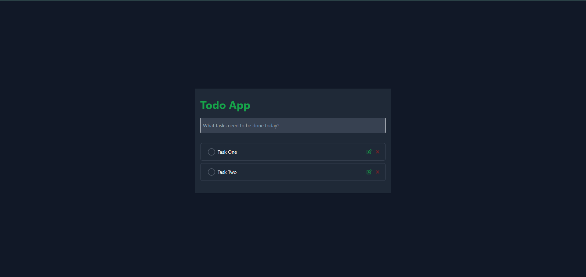

# Taskflow — React Todo

A modern, responsive task manager built with React and Vite. Taskflow focuses on a clear interface, quick task capture, and reliable browser-based persistence without requiring an account or backend.



## Features

- Create tasks with a title, optional description, priority, and due date.
- Edit task titles inline and mark tasks complete or active.
- Filter by all tasks, tasks due today, active tasks, or completed tasks.
- Search task titles and descriptions.
- View summary counts and completion progress.
- Remove individual tasks or clear completed tasks.
- Persist tasks in browser `localStorage`.
- Responsive layout for desktop, tablet, and mobile.
- Accessible labels, visible keyboard focus, and reduced-motion support.
- Zero additional runtime dependencies beyond React.

## Tech stack

- React 18
- Vite 5
- JavaScript (ES modules)
- CSS with responsive design tokens and component styles
- Browser `localStorage` for local persistence

## Requirements

- Node.js 18 or newer (Node.js 20 LTS recommended)
- npm

## Getting started

```bash
git clone https://github.com/arminmehraeen/React-Todo.git
cd React-Todo
npm install
npm run dev
```

Vite prints the local development URL (usually http://localhost:5173).

## Scripts

| Command | Purpose |
| --- | --- |
| `npm run dev` | Start the local development server |
| `npm run build` | Create an optimized production build in `dist/` |
| `npm run preview` | Preview the production build locally |
| `npm run lint` | Run ESLint |

## Production build

```bash
npm ci
npm run lint
npm run build
npm run preview
```

Deploy the contents of `dist/` to any static hosting provider that supports single-page applications, such as GitHub Pages, Netlify, Vercel, or Cloudflare Pages. Configure the host to serve `index.html` for application routes if routes are added in the future.

## Project structure

```text
React-Todo/
├── public/
│   └── favicon.svg
├── src/
│   ├── components/
│   │   ├── icons/
│   │   ├── todo_list.jsx
│   │   ├── todo_list_item.jsx
│   │   └── todos.jsx
│   ├── App.jsx
│   ├── index.css
│   └── main.jsx
├── index.html
├── package.json
└── README.md
```

The current interface and task workflow live in `src/App.jsx`, while `src/index.css` contains the design system, responsive layout, and component styling. The original component files are retained for easier incremental migration, but the main application uses the updated Taskflow interface.

## Data and privacy

Tasks are stored in the current browser profile using the key `taskflow.todos.v1`. Data is local to that browser and device; it is not synced to a server or shared across devices. Clearing browser site data may remove saved tasks. Export/import, cloud sync, accounts, and server-side backups are not currently included.

If browser storage is unavailable or full, persistence may fail. Do not use this local-only app as the sole storage location for critical information.

## Quality checklist

Before releasing a change:

1. Run `npm ci`.
2. Run `npm run lint`.
3. Run `npm run build`.
4. Verify create, edit, complete, delete, search, and each filter.
5. Verify persistence after a page refresh.
6. Check the layout at mobile and desktop widths.

## Roadmap

Potential future improvements include automated component tests, task export/import, recurring tasks, keyboard shortcuts, and optional cloud synchronization.

## Contributing

1. Create a feature branch.
2. Keep UI components accessible and responsive.
3. Run lint and production build checks.
4. Open a pull request with a concise description and test notes.

## License

See [LICENSE](LICENSE) if present in the repository.
